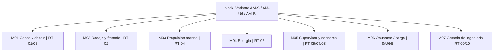
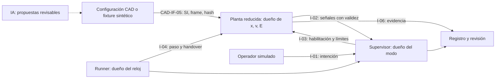
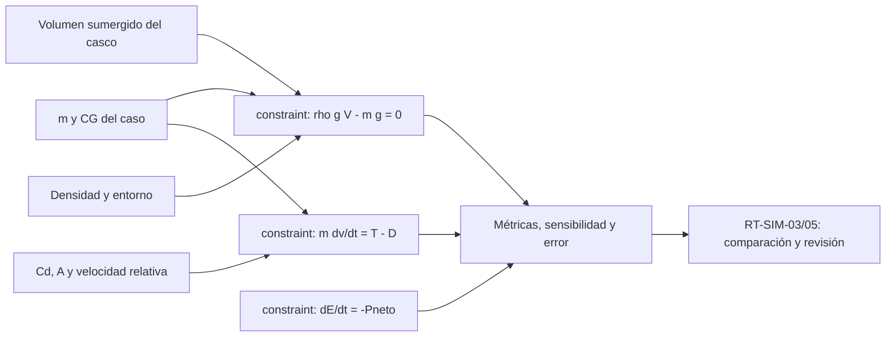
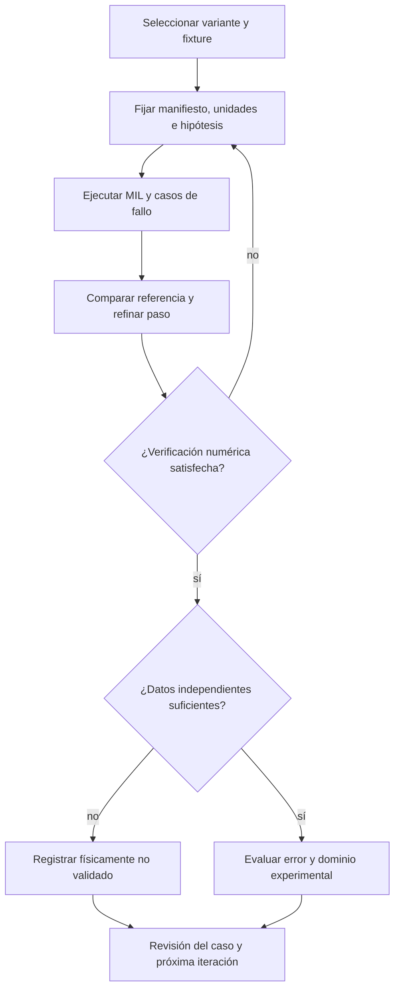

# RTESS-SIM-001 — Simulación y CAD modular de alto nivel

Revisión propuesta: 11 de octubre de 2026. Base: `7ed0ef3921dba62f912726698615a96a136a326c`. Referencia metodológica: [jfxai4dia PR #3](https://github.com/robotics-intelligent-systems/jfxai4dia/pull/3), documentación en revisión. Estado: documentación; no hay ejecuciones MIL/SIL/HIL ni correlación física realizadas por este paquete.

[Requisitos existentes](amphibious-high-level.md) · [Plan y presupuesto](../../docs/planning/portfolio-complexity-budget-simulation.md) · [Draw.io familiar](../CAS/jfxrtess-amphibian-car-cad-architecture.drawio) · [Draw.io AM-B](../CAS/OpenTwin_AM-B_Requirements_Engineering.drawio).

RT-01…RT-12, S-01/S-02, U6-01/U6-02 y B-01/B-02 mantienen sus significados. AM-01…AM-16, P01…P18 y V01…V16 del AM-B se conservan. No se sustituyen requisitos físicos por resultados sintéticos. Las nuevas obligaciones RT-SIM se limitan a documentación y ejecución científica de ingeniería.

## Configuraciones y asignación modular

| Concepto / misión propuesta | Módulos CAD lógicos | Requisitos asignados | Caso y limitación |
|---|---|---|---|
| AM-S: movilidad terrestre y acuática con operador | M01 casco/chasis; M02 rodaje/freno; M03 propulsión marina; M04 energía; M05 sensores/supervisor; M06 ocupante; M07 gemela | RT-01…12, S-01/02 | Primera simulación sintética de transición y flotación; ocupación/dimensiones TBD |
| AM-U6: movilidad con carga asegurada | M01…M07; M06 incluye sujeción de carga y reparto por ejes | RT-01…12, U6-01/02 | Casos de distribución de masa/CG; seis ruedas es intención conceptual, no geometría dimensionada |
| AM-B: movilidad individual anfibia | M01…M07; M06 incluye conductor, postura y equilibrio | RT-01…12, B-01/02; cruce con AM-B conservado | Balance conductor/vehículo y exposición; no extrapolar estabilidad de AM-S |

Los módulos son bloques funcionales propuestos. Cada variante tiene su ensamblaje: no se afirma que módulos de motocicleta, roadster y utilitario sean intercambiables.

| Interfaz modular | Contrato técnico propuesto | Trazabilidad | Cierre antes de CAD/MIL de ingeniería |
|---|---|---|---|
| CAD-IF-01 M02/M03 → M01 | Fuerzas N, momentos N·m, origen/ejes, anclajes, tolerancias y envolvente de cargas | RT-01/02/03, S-02, U6-02 | Coordenadas, patrón de fijación y cargas TBD por Mecánica |
| CAD-IF-02 M04 → M02/M03/M05 | Potencia W, tensión V si eléctrica, corriente A, calor W, aislamiento y límites | RT-06, D07 | Arquitectura energética TBC; límites TBD por Energía |
| CAD-IF-03 M05 → actuadores | I-02/I-03: comando limitado, validez, sello temporal, estado y respuesta degradada | RT-04/05/07/08 | Guards/deadlines TBD por Control |
| CAD-IF-04 M06 → M01 | Masa kg, CG m, carga por apoyo N, sujeción y acceso | S-01,U6-01,B-01/02 | Población/carga/dimensiones TBD por Sistemas/Mecánica |
| CAD-IF-05 geometría → M07 | I-04: variante, revisión/hash, unidad m, frame, volumen m³, masa kg e inercia kg·m² | RT-01/03/09 | Manifiesto y propiedad de estados; validación de conversión |

Para diseño modular dimensionado: ensamblaje y BOM por variante, sistema de coordenadas explícito, parámetros con unidad, tolerancias, volumen sellado y zonas mojadas, conectores/anclajes, accesos y colisiones. STEP/BREP sería exportación derivada con hash; no existe un archivo CAD paramétrico por declarar una imagen JPEG. D03, D05, D06 y D09 siguen abiertos.

## Requisitos adicionales de simulación

| ID | Obligación | Asignación | Verificación y criterio propuesto |
|---|---|---|---|
| RT-SIM-01 | Cada modelo deberá declarar ecuaciones, hipótesis, parámetros SI, dominio y estado de validación | M07 / RT-09 | Inspección: todos los términos/unidades definidos; ningún coeficiente sintético etiquetado medido |
| RT-SIM-02 | Cada ejecución deberá fijar configuración, integrador, reloj, paso y dueño de cada estado | M07 / I-04 | Revisión y replay: estados sin doble integración, hashes resolubles y entradas versionadas |
| RT-SIM-03 | El fixture deberá contrastar una solución analítica y estudiar reducción de paso | M07 / RT-03/09 | Caso prismático sintético: residual relativo de fuerza ≤1e-6; dinámica simple: error relativo normalizado ≤1% con referencia y pasos h,h/2,h/4; umbrales de fixture, no aceptación física |
| RT-SIM-04 | El supervisor deberá rechazar guards inválidos/obsoletos y registrar cambios | M05 / RT-04/05/10 | Todas las transiciones permitidas/prohibidas cubiertas en fixture; ausencia de doble habilitación salvo política explícita; respuesta según presupuesto simulado |
| RT-SIM-05 | Cada resultado deberá separar verificación numérica y validación experimental | M07 / RT-12 | Informe con error, incertidumbre, datos independientes y limitaciones; sin datos, estado “físicamente no validado” |
| RT-SIM-06 | El banco deberá medir deadline, jitter y latencia en hardware objetivo antes de afirmar tiempo real | M05/M07 / RT-07 | Informe de carga, plataforma, reloj y distribución de tiempos; MIL no satisface este requisito |

Propietarios propuestos: Sistemas para alcance, Simulación para 01/02/03/05, Control para 04/06, Mecánica para CAD. No hay personas asignadas ni baseline aprobada. Los criterios físicos originales no se dan por cerrados.

## Principios científicos y dominio de validez

| Modelo | Relaciones de primer principio / magnitudes | Hipótesis y datos requeridos | Evidencia y trazabilidad |
|---|---|---|---|
| Masa y CG | m=Σmᵢ; rCG=Σmᵢrᵢ/m; tensor de inercia y ejes coherentes | BOM y posiciones medidos o sintéticos declarados; carga fija por caso | RT-01, S-01,U6-01,B-01; comparar suma y pesaje cuando exista |
| Hidrostática | B=ρgVdesplazado; equilibrio B=mg; momentos de flotación/peso | Agua quieta, volumen estanco; geometría/CG conocidos; no cubre planeo, olas ni entrada violenta al agua | RT-03; fixture prismático; estabilidad requiere curva de brazos adrizantes, no solo B=mg |
| Dinámica terrestre | m·dv/dt=Ftracción−Ffreno−Fresistencia−mg·sin(α) | Modelo longitudinal inicial, contacto/adhesión limitados; no identifica vuelco, equilibrio de moto ni frenada real | RT-02; solución constante/lineal de referencia; calibrar fuerza y masa |
| Dinámica acuática reducida | m·dv/dt=T−D; D≈ρCdA·vrel·abs(vrel)/2 | Cd/A emparejados y dependientes del régimen; superficie libre, masa añadida y transiciones exigen modelos adicionales | RT-04/09; sensibilidad a Cd; no extrapolar un Cd aerodinámico al casco |
| Energía y temperatura | dE/dt=−Pneto; Cth·dT/dt=Ppérdidas−Qsalida | Sistema concentrado, mapa de eficiencia y pérdidas; batería/combustible son alternativas TBC | RT-06; balances energéticos y comparación con banco |
| Supervisor híbrido | Estados discretos con guards, timeouts y dinámica continua por modo | Dueño de reloj explícito; señales con validez/edad; interbloqueos locales | RT-04/05/07/08; tabla de transiciones, fallos y trazas |

g en m/s²; ρ en kg/m³; volumen en m³; v en m/s; Cd adimensional; A en m²; Cth en J/K; energía en J. Usar energía kWh solo tras conversión explícita (1 kWh=3,6 MJ). Vdesplazado es volumen sumergido, no volumen total de la imagen. Peso y empuje son fuerzas, no masas.

La [ecuación de resistencia de NASA](https://www1.grc.nasa.gov/beginners-guide-to-aeronautics/drag-equation/) fundamenta el término cuadrático y la necesidad de especificar área/coeficiente; su aplicación reducida al agua aquí es una hipótesis que exige calibración. [NIST VVUQ](https://www.nist.gov/publications/methods-uncertainty-quantification-computational-modeling-and-simulation-harmonizing) distingue credibilidad, incertidumbre y consecuencias de uso; se adopta revisión proporcional al riesgo. La IA propone parámetros/documentos/código, pero no es un solver ni sustituye datos independientes.

## Vistas SysML de alto nivel

Las vistas siguientes aproximan BDD, IBD, paramétrico y actividad de SysML 1.6 para comunicación. Mermaid y las cajas Draw.io no son un modelo SysML ejecutable, no generan XMI ni validan semántica automáticamente. Referencia: [OMG SysML 1.6](https://www.omg.org/spec/SysML/1.6/About-SysML). Un futuro modelo nativo deberá fijar herramienta, versión y relaciones formales satisfy/verify/refine.

### BDD: composición y asignación

### IBD: simulación y propiedad de interfaces

### Paramétrico: restricciones e incertidumbre

### Actividad: ejecución y aceptación

## Fixture propuesto y procedimiento reproducible

Se ejecutará en RTESS-SIM-002. Esta revisión define entradas/resultados esperados; no contiene solver ejecutado.

Prisma sintético de estudio: m=500 kg, rho=1000 kg/m³, g=9,81 m/s², eslora=3 m, manga=1,5 m, altura estanca=0,8 m, CG simétrico. No son dimensiones del AM-S. V=m/rho=0,5 m³; calado=V/(3×1,5)=0,111111… m; francobordo geométrico=0,688889… m; B=W=4905 N. Esta comprobación no determina estabilidad, vuelco, estructura o aptitud anfibia.

1. Crear manifiesto con `synthetic=true`, unidades SI, semilla fija si aplica, revisiones y dueño de estado/reloj.
2. Calcular equilibrio y residual; comparar con valores analíticos. Rechazar m≤0, rho≤0, volumen no finito y mezcla de unidades.
3. Añadir caso longitudinal de fuerza constante con v(t)=v0+Ft/m y x(t)=x0+v0t+Ft²/(2m); repetir h,h/2,h/4. Registrar integrador y error absoluto/relativo normalizado, evitando dividir por referencia cero.
4. Inyectar inmersión válida, obsoleta, contradictoria, pérdida de enlace y fallo de actuador; fijar edades/timeouts sintéticos en el fixture, separados de D08 físico.
5. Registrar por caso: ID, RT aplicables, entradas/hash, resultados, tolerancia, veredicto, reloj y limitaciones. Segunda ejecución deberá reproducir métricas dentro de tolerancia fijada.
6. Revisar contra RT-SIM-01…05. RT-SIM-06 queda pendiente de hardware. Toda conclusión física requiere D03/D05/D06/D09 y datos independientes cerrados.

## Plan, avance y siguiente tarea IA

Estimación de la primera fase MIL: 80–160 h, 4–8 semanas a 20 h/semana; costo económico S/4.750–10.125 según supuestos del plan; desembolso aportando PC/trabajo S/750–2.125. Reparto: alcance/ICD 12–24 h, geometría/fixture 16–32 h, modelos/supervisor 24–48 h, verificación 20–40 h, revisión 8–16 h. Estos tiempos ya contemplan asistencia IA, sin prometer velocidad por modelo.

Entregado documentalmente: asignación CAD, seis requisitos RT-SIM, modelos teóricos, cuatro vistas Mermaid/SysML, páginas Draw.io y criterios de fixture. Pendiente: parámetros físicos aprobados, implementación MIL, ejecución, correlación y banco. El perfil mantiene ~20% editorial global; progreso de documentación no significa simulación terminada.

Tarea propuesta **RTESS-SIM-002**: implementar fixture prismático y runner MIL con manifiesto SI, comparación analítica, rechazo de entradas inválidas, guards y replay; iniciar con GPT-6.1 Sol, revisar hipótesis con Astra si disponible. Registro de fuente: [OpenAI modelos](https://learn.chatgpt.com/docs/models). Selección del plan por presupuesto y gobierno, no por CAPEX del sistema simulado.
