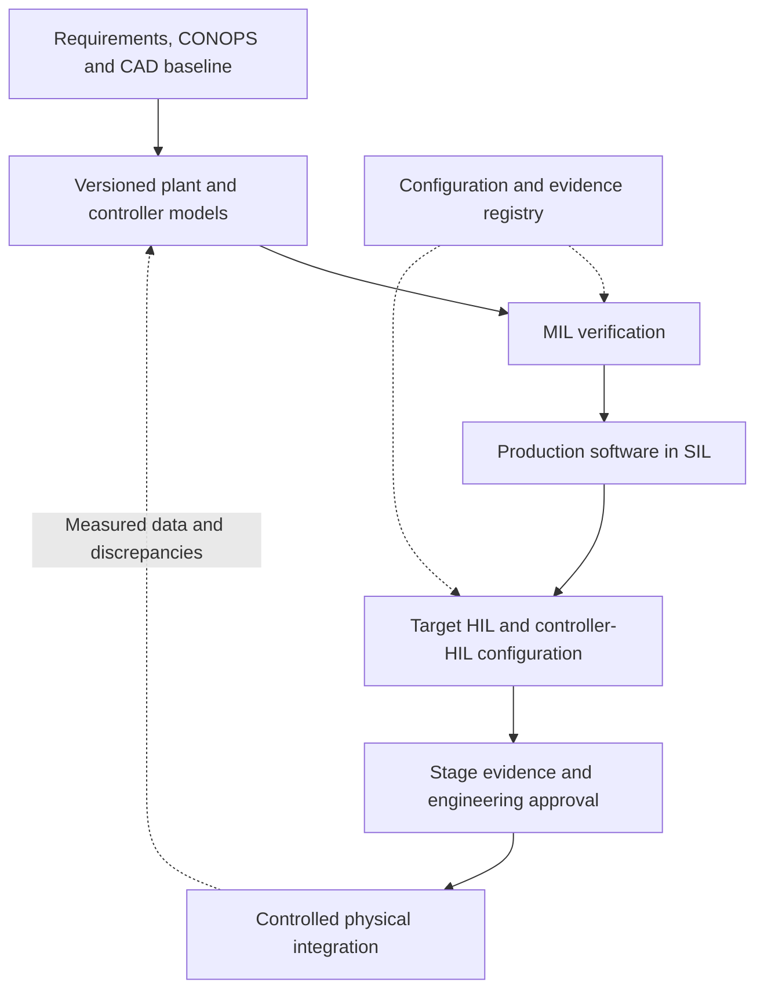
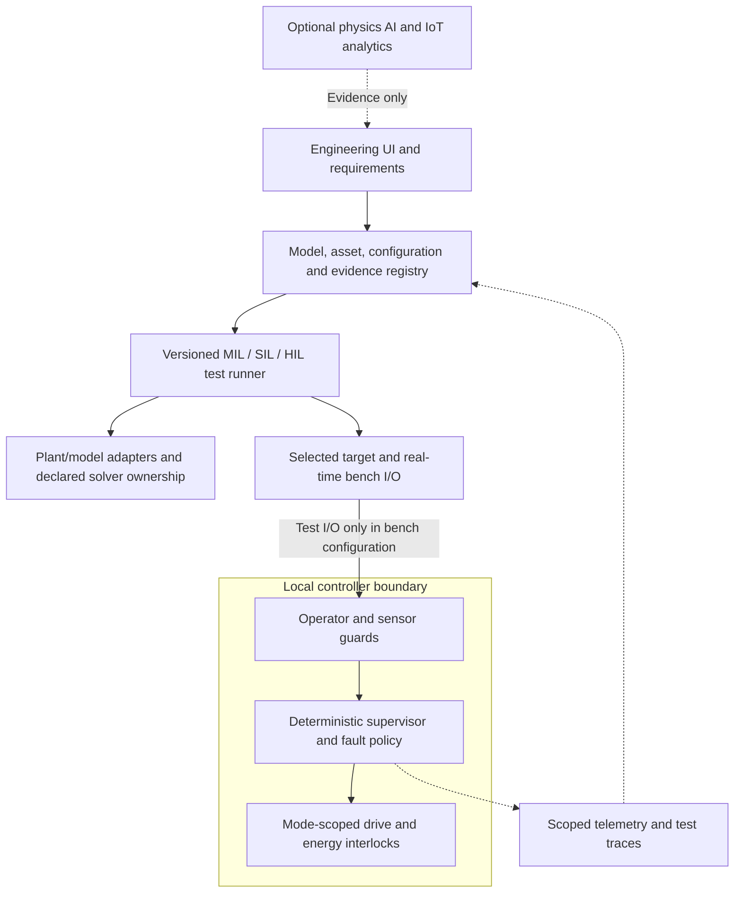
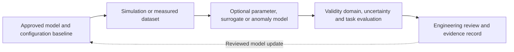
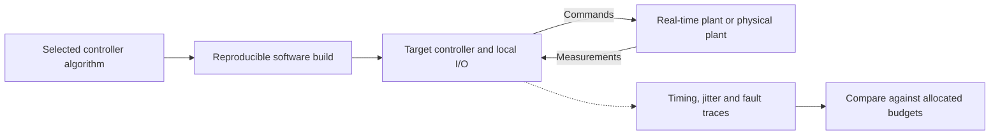
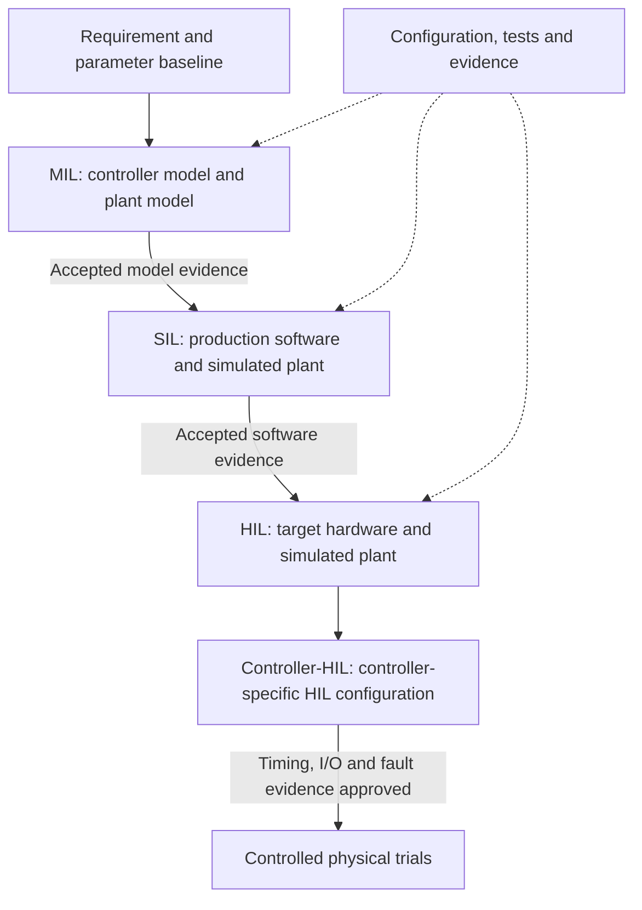
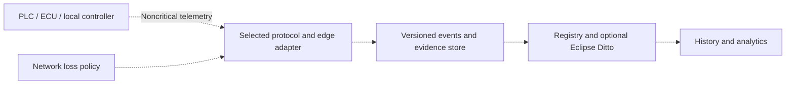
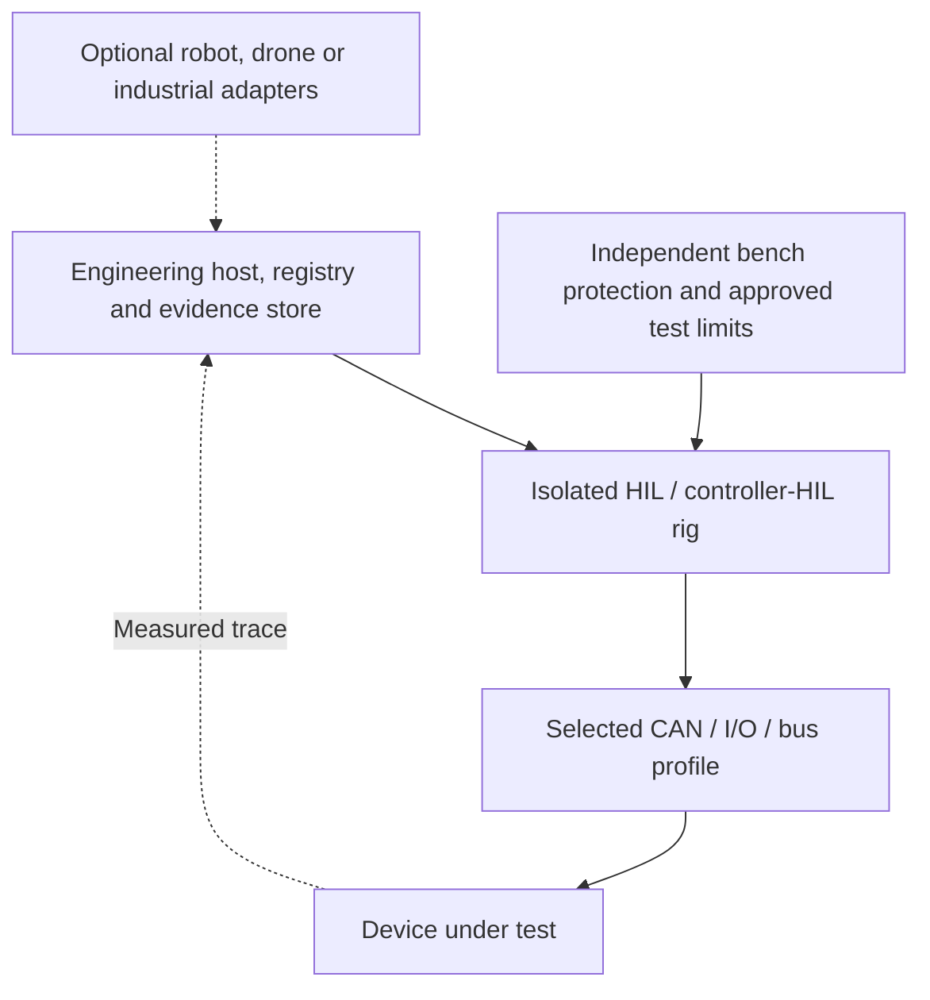
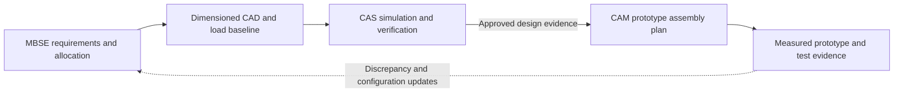
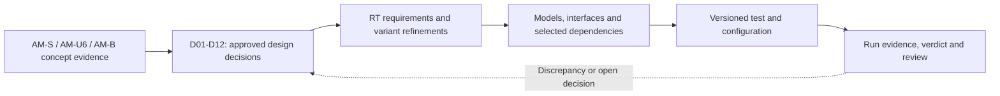
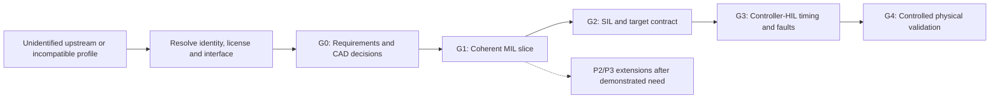

# jfxrtess --- OpenTwin Physics-Driven AI for Real-Time Embedded Systems

> Open-source reference architecture for Electronic Design Automation
> (EDA), real-time simulation, Rapid Control Prototyping (RCP),
> MIL/SIL/HIL/CHIL verification, embedded systems, FPGA/RISC-V,
> industrial IoT, and digital twins.

## Scientific simulation, SysML and portfolio planning

[RTESS-SIM-001: modular CAD, scientific models and SysML views](MBSE/requirements/scientific-simulation-sysml.md) · [Complexity, budgets and AI-assisted simulation plan](docs/planning/portfolio-complexity-budget-simulation.md). Documentation proposed on 2026-10-11; simulation execution and physical validation remain pending.

## Description and Context

**jfxrtess / OpenTwin Physics-Driven AI for Real-Time Embedded Systems**
consolidates the project's technology compendium into a structured
architecture for EDA, model-driven engineering, real-time simulation and
testing, rapid control prototyping, controller-hardware-in-the-loop,
embedded software, programmable hardware, industrial connectivity, and
digital twins.

The source project is titled **Physics-Driven AI for Electronic Design
Automation** and describes real-time simulation and CHiL. Its technology
survey includes OpenEmbedded, SystemC tooling, LLVM/Clang, RISC-V
virtualization, OpenModelica-HIL, Calyx, PyMTL, Chisel, SpinalHDL,
Verilator, Chipyard, KiCad, OpenPLC, NuttX, Cyphal/CAN, Eclipse IoT
technologies, Eclipse Ditto, Apache IoTDB, PLC4X and related
embedded/industrial technologies.

This document assigns candidate tools to responsibilities and adoption priorities. The repository contains architecture documentation, two editable Draw.io files and three CAD-directory concept images; the architecture is proposed, not an integrated executable stack.

Navigation: [Dependency priorities](#categorized-and-prioritized-dependencies) · [CAD concepts and requirements](#cad-concepts-and-high-level-requirements) · [Traceability matrix](MBSE/requirements/amphibious-traceability.csv).

## Vision



## Objectives

-   Provide a modular architecture for real-time embedded-system
    engineering.
-   Connect MBSE requirements to executable models and verification
    evidence.
-   Support MIL, SIL, HIL and CHIL workflows.
-   Support Rapid Control Prototyping.
-   Integrate physics-based simulation through replaceable adapters.
-   Support FPGA, HDL, RISC-V, RTOS and embedded-software research.
-   Provide industrial IoT and digital-twin interoperability.
-   Preserve telemetry, configuration, model and test provenance.
-   Support Physics-Driven AI with explicit verification gates.
-   Minimize vendor lock-in through open interfaces.

## Reference Architecture



Cross-cutting concerns: **Functional Safety · Cybersecurity ·
Determinism · Traceability · Configuration Management · Reproducibility
· Observability · Open Interfaces**.

## OpenTwin RTES Model

Candidate twins include System Twin, Controller Twin, Plant Twin, Sensor
Twin, Actuator Twin, ECU Twin, PLC Twin, FPGA Twin, RISC-V Compute Twin,
Network Twin, Test Bench Twin, HIL Rig Twin and Mobile Laboratory Twin.

``` yaml
twin:
  id: controller-001
  type: embedded-controller
  configuration:
    target: generic
    firmware_version: dev
    interfaces: []
  state:
    mode: simulation
    health: {}
    timing: {}
  model_refs: []
  telemetry_refs: []
  test_refs: []
  provenance: {}
```

## Physics-Driven AI and EDA

Potential applications include reduced-order models, parameter
estimation, anomaly detection, predictive diagnostics, surrogate plant
models, design-space exploration, test prioritization and simulation
acceleration.



AI results should remain traceable to model versions, datasets,
assumptions, uncertainty and validation evidence.

## Real-Time Simulation and Rapid Control Prototyping



Potential functions include deterministic simulation, real-time I/O,
controller tuning, plant-model execution, telemetry capture, fault
injection, timing analysis and automated testing.

## MIL SIL HIL and CHIL



Each transition preserves requirements-to-test traceability and configuration baselines. CHIL is a controller-HIL configuration, not an automatically stronger verification level. A simulator or RTOS name alone does not establish a real-time deadline.

## Embedded Computing and FPGA

The compendium supports research involving RISC-V, SystemC, PyMTL,
Chisel, SpinalHDL, Verilator, Calyx, Chipyard, embedded virtual
machines, RTOS platforms, open embedded build systems and EDA tools.

## Industrial IoT and Digital Twins



Candidate integrations include Eclipse Mosquitto, Eclipse Paho, Eclipse
Hono, Eclipse Ditto, Apache IoTDB and Apache PLC4X.

## OpenTwin Mobile Field Laboratory

The architecture can also support a generic mobile engineering
laboratory:



Possible uses include mobile commissioning, infrastructure testing,
robotics integration, field telemetry, temporary HIL laboratories and
digital-twin synchronization. This is a generic OpenTwin architecture,
not a claim of implementation or certification of third-party reference
hardware.

## MBSE → CAD → CAM → CAS

The source repository explicitly organizes engineering around:



**MBSE:** Arcadia/Capella can structure stakeholder needs, operational
analysis, system analysis, logical architecture, physical architecture
and verification traceability.

**CAD:** electronics, PCBs, enclosures, test fixtures, mobile
laboratories and control panels.

**CAM:** manufacturing and assembly planning for independently developed
prototype hardware.

**CAS:** end-to-end system simulation and performance analysis before
physical integration.

## Technology Compendium Scope

The catalog below retains the embedded/EDA/industrial survey, including references omitted from the previous short table and historical references (Rellic, SLANG, Rumoca, robot-arm simulation, CANopen and Adamant), and adds the FreeCAD, OpenModelica, OpenFOAM, ROS 2, Gazebo and Godot toolchain named in the CAD concept captions. FMI is added as an explicit interchange contract. Tools, standards, commercial references and unidentified projects are distinguished.

## CAD Concepts and High-Level Requirements

| Concept | CAD-directory source | Engineering questions |
|---|---|---|
| AM-S roadster | [Concept image](MBSE/CAD/amphibious-sport-roadster.jpg) | Occupant packaging, loaded hull, road dynamics, drive allocation and transitions. |
| AM-U6 utility | [Concept image](MBSE/CAD/deeper-vehicle-immersion-in%20water-mode.jpg) | Cargo restraints, six-wheel proposal, load-dependent CG/waterline and service access. |
| AM-B motorcycle | [Concept image](MBSE/CAD/amphibious-motorcycle-concept.jpg) | Rider balance, wet boundaries, propulsion immersion and local controls. |

These are concept JPEGs, not dimensioned CAD models. Numerical specifications require approved dimensions, mass/CG, load cases, operating envelope and measurements. The images do not establish autonomy, wheel retraction, hydrofoils, electrical architecture or physical performance.

The [high-level requirements baseline](MBSE/requirements/amphibious-high-level.md) defines 12 common requirements (RT-01–RT-12), six variant refinements, interfaces I-01–I-06 and open decisions D01–D12. The [CSV traceability matrix](MBSE/requirements/amphibious-traceability.csv) assigns owners, methods, acceptance criteria, tools and AM-B cross-references. No tests are reported as executed.

- [AM-S / AM-U6 family Draw.io](MBSE/CAS/jfxrtess-amphibian-car-cad-architecture.drawio): six editable pages for context, shared requirements, variants, interfaces, verification and decisions.
- [AM-B Draw.io](MBSE/CAS/OpenTwin_AM-B_Requirements_Engineering.drawio): the original AM-01–AM-16, P01–P18 and V01–V16 are retained across six revised pages, with a seventh family/dependency crosswalk page.

The prior car diagram's assumed autonomy, retracting wheels, hydrofoils, hard-coded response times, IP68 rating and nonexistent STEP/parser assets are replaced by explicit decisions and verification gates. AM-B's 20 ms supervisor, 5 Hz selected-state telemetry and 30 min buffer remain review proposals, not measured values or shared family requirements.



## User Guide

1.  Define requirements and CONOPS.
2.  Create the MBSE architecture.
3.  Define plant and controller models.
4.  Register models and assets in OpenTwin.
5.  Run MIL verification.
6.  Integrate production software for SIL.
7.  Configure representative hardware.
8.  Execute HIL/CHIL tests.
9.  Capture timing and telemetry.
10. Compare results with acceptance criteria.
11. Record model, firmware and hardware configurations.
12. Attach verification evidence.
13. Progress to controlled field testing when applicable.

## Installation Guide

``` bash
git clone https://github.com/robotics-intelligent-systems/jfxrtess.git
cd jfxrtess
```

The repository should be treated primarily as a technology compendium
and engineering reference architecture unless a specific module provides
executable installation instructions. Do not assume that every
referenced technology must be installed.

A minimal target implementation can contain an Engineering UI, OpenTwin
API, Twin/Model Registry, simulation adapter and results/provenance
store.

## Categorized and Prioritized Dependencies

Review: **2026-10-10**, repository baseline `74df5ba75c6cb1b90dc581ba9a2feb848edf0a3d`. This is an architecture/documentation repository, not an installed software stack. Selection depends on the demonstrator, target board, model format and test profile.

**P0:** foundation for the first coherent requirements/CAD/MIL slice. **P1:** first SIL/embedded/controller-HIL integration. **P2:** requirement-driven extension. **P3:** research/reference. Priorities are proposed adoption order, not upstream maturity scores. **HOLD** means the concrete repository, package or interface still needs identification before adoption. Required capabilities do not make every listed implementation mandatory.

### Requirements, CAD and physics

| Candidate / reference | Type | Priority | Role and selection gate |
|---|---|---|---|
| Arcadia / Capella | Method / modeling tool | P0 engineering | Requirements, allocation and traceability; version-controlled IDs are required even if another editor is selected. |
| FreeCAD | CAD authoring tool | P0 engineering | Create actual geometry, load and mass/CG baselines for AM-S/AM-U6/AM-B; source JPEGs are not CAD. |
| OpenModelica | Physics/control tool | P0 candidate | First coherent plant/controller MIL model; validate the selected libraries and state/solver contract. |
| FMI / FMU interchange | Interface standard | P0 contract | Pin version and Model Exchange/Co-Simulation profile; validate exporter/importer capabilities. No real-time guarantee follows from FMU packaging. |
| Gazebo | Simulation extension | P1 conditional | Land dynamics/scenarios where needed; avoid integrating the same state in both Gazebo and Modelica. |
| OpenFOAM | Offline CFD tool | P2; promote if needed for G1 | Hydrodynamic coefficients/fidelity studies and validity domain; do not place unbenchmarked CFD in the real-time plant loop. |
| Godot | Optional visualizer | P2 | Concept/test visualization; rendering is outside the local control deadline and is not physical verification. |
| Backhoe mechanism / hydraulic arm models | Domain examples | P3 / HOLD | Preserve as surveyed examples, not amphibious-vehicle dependencies; identify exact model/library before reuse. |
| Rumoca | Modelica compiler alternative | P3 / HOLD | Historical compiler reference; identify upstream and compare supported semantics before replacing the model toolchain. |
| Real-Time Robot Arm Simulator | Robotics domain reference | P3 / HOLD | Preserve historical simulator reference; separate robot-arm scope from amphibious requirements. |
| OpenModelica-HIL-Simulation | HIL library candidate | P1 / HOLD | Identify exact library revision and target/I/O support; measure step execution and fault behavior on the selected bench. |
| Arduino sketches in Modelica | Co-simulation reference | P3 / HOLD | Identify the intended integration; only use after the board/compiler/model boundary is tested. |
| EmbedSim | Simulation alternative | P3 / HOLD | Comparative control/simulation reference; identify upstream and avoid duplicate plant authority. |

### Embedded targets, build and networking

| Candidate / reference | Type | Priority | Role and selection gate |
|---|---|---|---|
| Rellic | Reverse-engineering compiler reference | P3 | Preserve historical LLVM-bitcode analysis reference; no controller toolchain adoption without a migration use case. |
| SLANG shading language | Graphics compiler reference | P3 / HOLD | Identify the intended shading-language project; not a local-control dependency. |
| LLVM / Clang | Compiler toolchain | P1 conditional | Select compiler/ABI for the chosen target and reproducible SIL/firmware build. |
| Apache NuttX | RTOS candidate | P1 | Evaluate one target RTOS against I/O, deadlines, memory and fault policy; not automatic safety assurance. |
| Eclipse ThreadX / NetX Duo | RTOS / network alternative | P2 | Compare with selected OS/network requirements; do not deploy two RTOS stacks by default. |
| OpenEmbedded | Embedded Linux build | P2; P1 for Linux gateway | Pin board layers and recipes for a selected host/gateway. Not required for the first MCU controller. |
| meta-mono | OpenEmbedded layer | P3 conditional | Only if an approved .NET/Mono workload exists on the chosen gateway; verify layer/runtime compatibility. |
| CANopen protocol stack | Embedded transport alternative | P2 / HOLD | Name the stack and device profile if CANopen devices are selected; CANopen and Cyphal are distinct protocols. |
| Adamant | Model-driven framework reference | P3 / HOLD | Historical component-based framework reference; identify upstream and assess target/build contract before adoption. |
| Cyphal / CAN transport in C | Embedded transport candidate | P1 | Pin concrete library and node profile; verify bus load, freshness, timeouts and physical CAN configuration. |
| Eclipse Cyclone DDS | Engineering middleware | P1 conditional | Host/bench data distribution with measured QoS and load; no hard real-time guarantee assumed. |
| ROS 2 | Engineering integration | P1 conditional | Scenario/test adapters shown in concept toolchain; keep local actuator authority separate and validate clock/transport profile. |
| Eclipse Mosquitto | MQTT broker | P1 telemetry | Optional first host telemetry path; control and faults remain local during loss. |
| Eclipse Paho | MQTT clients | P1 conditional | Only for selected telemetry clients; validate replay, validity and reconnect behavior. |
| SweetAda | Embedded development alternative | P3 | Evaluate for a specific target/language requirement before adding build/runtime obligations. |
| OMicroB | OCaml VM reference | P3 | Constrained-runtime research; no need in the selected controller baseline is established. |
| RISC-V Virtual Machine | Virtual target reference | P3 / HOLD | Name the implementation and ISA/platform profile; ISA alone is not a VM dependency. |
| Sunflower | Emulator reference | P3 / HOLD | Identify exact source/version and supported target before using as verification evidence. |
| UxAS | Modular autonomy services | P3 conditional | Separate autonomy research; operator-controlled CAD concepts do not establish autonomous-vehicle requirements. |

### Electronics, FPGA and silicon research

| Candidate / reference | Type | Priority | Role and selection gate |
|---|---|---|---|
| KiCad | EDA engineering tool | P1; before physical bench | Schematics/PCB and interface documentation for the selected electronics, with review and hardware validation. |
| Verilator | RTL simulation candidate | P2; P1 for FPGA demonstrator | RTL simulation/regression; not a substitute for target timing or electrical validation. |
| FuseSoC / OpenRISC cores | Core packaging / IP reference | P2 conditional | Select one licensed core/toolchain with reproducible integration and board constraints. |
| Chisel | HDL construction alternative | P2 | Select when a Scala-based RTL design is justified; generated RTL still needs verification. |
| SpinalHDL | HDL construction alternative | P2 | Alternative to another HDL generator, rather than a mandatory parallel toolchain. |
| PyMTL | Hardware modeling framework | P2 | Generation/simulation/verification experiments with explicit interface and RTL comparison. |
| Chipyard | RISC-V SoC research framework | P3; promote for SoC scope | Large SoC research path outside the first amphibious controller slice. |
| Calyx | Hardware compiler research | P3 | Accelerator/dataflow experiments; require task-specific correctness evidence. |
| SODA Synthesizer | Silicon compiler research | P3 | Evaluate only for a defined synthesis research objective and supported backend. |
| ViPER / SystemC | Virtual-platform tooling | P2 / HOLD for ViPER | Identify the GUI implementation and SystemC profile; platform inspection does not prove target equivalence. |
| LVGL simulator / SDL | UI prototyping tooling | P2 | Display simulation; UI rendering is isolated from control and test timing. |

### Industrial systems, data and optional twins

| Candidate / reference | Type | Priority | Role and selection gate |
|---|---|---|---|
| OpenPLC | PLC runtime candidate | P2; P1 for PLC bench | Only for a selected industrial/PLC demonstrator with I/O and scan-cycle evidence. |
| Factory I/O | Commercial simulation reference | P3 external | Optional comparison/test plant; not an open-source or mandatory cloud/runtime dependency. |
| Apache PLC4X | Industrial protocol integration | P2 | Selected protocol/device adapter with access and data-freshness tests. |
| Kafka Connect / KSQL | Data pipeline candidates | P2 / HOLD for KSQL identity | Identify platform, connectors and versions; asynchronous analytics are outside the local control path. |
| Eclipse Ditto | Optional twin platform | P2 | Evaluate for asset state and API needs; correct the earlier “Apache Ditto” attribution to Eclipse. Registry capability is P0; this implementation is optional. |
| Apache IoTDB | Time-series store | P2 | Select when volume/retention/query requirements exceed the first evidence store. |
| Eclipse Hono | IoT connectivity | P2 | Device onboarding/telemetry at scale, after one local path is verified. |
| Neuron | Industrial connectivity server | P2 / HOLD | Identify exact edition, repository and license; test only required protocols. |
| contexus IoT Platform | Platform reference | P3 / HOLD | Upstream identity and spelling need resolution; no concrete adoption is claimed. |
| White Label Digital Twin Framework | Unspecified framework reference | P3 / HOLD | Identify upstream; avoid introducing another registry without a measured gap. |
| CAPS | Model-driven framework reference | P3 / HOLD | Identify exact framework/project and its interchange contract. |
| openHAB | Automation reference | P3 | Home/building automation comparison, separate from amphibious local control. |
| SIAPP SDK | Industrial SDK reference | P3 / HOLD | Select exact device/SDK, distribution terms and interface before use. |
| UA Cloud Twin | OPC UA twin reference | P2 / HOLD | Identify implementation and deployment profile; no cloud dependency in essential control. |
| Azure IoT Edge OCPP module | External integration reference | P3 / HOLD | Identify module and OCPP profile for an actual charging requirement; not part of the initial vehicle loop. |
| Eclipse Grizzly | Networking framework reference | P3 | Introduce only for a justified host-service requirement. |

The source survey names protocols (CAN, DDS, MQTT, OPC UA, Modbus and S7) as well as products. Protocol support must be tied to a concrete adapter, version and device profile.

### Priority rationale and release gates

| Gate | Focus | Required evidence |
|---|---|---|
| G0 | Scope, requirements and dimensioned CAD | Owners close affected D01–D12 decisions; source/load/configuration and acceptance criteria approved. |
| G1 | P0 model, controller and registry slice | One coherent MIL run; unit/frame/clock ownership, inputs, output and requirement verdicts recorded. |
| G2 | P1 software/target selection | Reproducible SIL comparison, selected MCU/RTOS/I/O contract and tested fault policy. |
| G3 | P1 controller-HIL bench | Actual execution-time/jitter, deadline, bus-load, I/O and fault-response traces satisfy approved budgets. |
| G4 | Controlled physical prototype | Geometry, mass/CG, flotation, dynamics, ingress/service and applicable stage approvals verified within an accepted envelope. |
| Extensions | P2/P3 candidates | Demonstrated gap, pinned source/license/ABI, adapter acceptance and rollback before promotion. |

Select one baseline plant/control toolchain, one controller runtime and one initial evidence/telemetry path. Requirements, provenance, interface versioning and fault analysis begin at G0; they are not postponed to the last roadmap phase. Resolve HOLD identities before adoption. Each selected component records owner, upstream, pinned revision, license/dependency notices, build/profile, interfaces, resource limits, acceptance evidence and replacement plan.



### Sources and review limits

Candidate roles derive from the repository survey and CAD concept captions; priorities and requirements allocations are engineering proposals. No full security, maintenance or license audit of every candidate is claimed. Selected official sources reviewed on 2026-10-10:

- [Historical project survey](https://github.com/robotics-intelligent-systems/jfxrtess/blob/7a5359b8effd2043f9802a504fb5ecce8c34b97f/README.md): source of retained Rellic, SLANG, Rumoca, robot-arm, CANopen and Adamant references.
- [OpenModelica](https://openmodelica.org/): modeling and simulation environment; specific libraries and real-time execution require separate verification.
- [FMI](https://fmi-standard.org/): model interchange standard; pin version/profile and adapter capabilities.
- [Gazebo architecture](https://gazebosim.org/docs/harmonic/architecture/): simulation and physics integration;
- [Apache NuttX](https://nuttx.incubator.apache.org/docs/latest/introduction/about.html): RTOS candidate; selected board deadlines require measurement.
- [Cyclone DDS](https://github.com/eclipse-cyclonedds/cyclonedds): data-distribution candidate; transport/profile performance must be tested.
- [Eclipse Ditto](https://eclipse.dev/ditto/): IoT digital-twin framework, with optional adoption in this architecture.


## Recommended Repository Structure

``` text
jfxrtess/
├── README.md
├── LICENSE
├── CONTRIBUTING.md
├── CODE_OF_CONDUCT.md
├── docs/
├── MBSE/
│   ├── operational/
│   ├── system/
│   ├── logical/
│   ├── physical/
│   ├── requirements/
│   ├── CAD/
│   ├── CAM/
│   └── CAS/
├── twins/
│   ├── registry/
│   ├── controller/
│   ├── plant/
│   ├── compute/
│   ├── network/
│   └── testbench/
├── models/
├── simulation/
│   ├── mil/
│   ├── sil/
│   ├── hil/
│   └── chil/
├── rcp/
├── eda/
├── fpga/
├── riscv/
├── rtos/
├── plc/
├── iot/
├── protocols/
├── physics_ai/
├── verification/
├── integrations/
├── api/
├── events/
├── provenance/
├── deployment/
├── tests/
└── examples/
```

## MVP

The MVP should provide a project/system registry, controller and plant
twins, model registry, configuration/version tracking, MIL simulation
adapter, SIL interface, event/telemetry history, verification records,
REST API and reproducible development environment.

Success criteria include reproducible models/configurations, traceable
controller/plant state, preserved simulation inputs/outputs,
requirements linked to verification evidence, recorded model/software
versions, comparable runs and no mandatory proprietary cloud.

## Development Roadmap

### Phase 1 --- Architecture

Requirement IDs, model/configuration provenance, interface contracts and fault-policy ownership start here; Phase 9 expands their tooling rather than introducing traceability for the first time.

-   [x] BID-inspired documentation organization.
-   [x] Technology-compendium consolidation.
-   [x] OpenTwin RTES architecture.
-   [x] Initial twin taxonomy.
-   [ ] Architecture Decision Records and formal schemas.

### Phase 2 --- Core Digital Twin Platform

-   [ ] Twin and model registries.
-   [ ] State/history and configuration management.
-   [ ] Provenance and event interfaces.

### Phase 3 --- MIL/SIL

-   [ ] Physics/controller adapters.
-   [ ] MIL/SIL runners.
-   [ ] Automated result comparison.

### Phase 4 --- HIL/CHIL and RCP

-   [ ] Deterministic runtime interface.
-   [ ] Real-time I/O.
-   [ ] HIL/CHIL adapters.
-   [ ] Fault injection and timing analysis.

### Phase 5 --- Embedded Hardware

-   [ ] MCU abstraction.
-   [ ] RISC-V integration.
-   [ ] FPGA/RTL workflow.
-   [ ] RTOS and virtual platforms.

### Phase 6 --- Industrial Connectivity

-   [ ] CAN/Cyphal, DDS, MQTT, OPC-UA and PLC adapters.
-   [ ] Edge gateway.

### Phase 7 --- Physics-Driven AI

-   [ ] Surrogates.
-   [ ] Parameter estimation.
-   [ ] Anomaly detection.
-   [ ] Uncertainty and AI provenance.

### Phase 8 --- Mobile Field Laboratory

-   [ ] Portable test topology.
-   [ ] Rugged networking.
-   [ ] Mobile HIL/CHIL.
-   [ ] Field telemetry and safety architecture.

### Phase 9 --- MBSE and Verification

-   [ ] Expanded Capella traceability and change-impact tooling.
-   [ ] Requirements-to-test links.
-   [ ] Verification reports and baselines.

### Phase 10 --- Production Hardening

-   [ ] CI/CD.
-   [ ] Reproducible builds.
-   [ ] Security and performance testing.
-   [ ] Backup/recovery and release governance.

## How to Contribute

Contributions are welcome in real-time simulation, embedded systems,
control engineering, Modelica, EDA, FPGA/HDL, RISC-V, RTOS, PLCs,
industrial IoT, digital twins, Physics-Driven AI, MBSE, HIL/CHIL,
cybersecurity, verification and documentation.

Pull requests should document scope, architecture impact, real-time
implications, interfaces, dependencies/licenses, hardware assumptions,
safety/security implications, tests and verification evidence.

Do not commit credentials, proprietary hardware designs, confidential
industrial data, restricted firmware or third-party material without
appropriate rights.

## Code of Conduct

Contributors should maintain a respectful, inclusive, professional and
technically constructive environment. A dedicated `CODE_OF_CONDUCT.md`
is recommended.

## Authors and Maintainers

Maintained by the **Robotics Intelligent Systems** open-source
initiative.

Repository: `robotics-intelligent-systems/jfxrtess`

Third-party software, trademarks, models, hardware descriptions,
datasets and documentation remain the property of their respective
owners.

## Additional Information

The project can serve as an open RTES technology compendium,
digital-twin architecture reference, HIL/CHIL research architecture,
embedded/EDA integration reference, MBSE-to-verification framework and
foundation for mobile engineering laboratories.

## Intellectual Property and Open Design

OpenTwin RTES favors open standards, documented interfaces, modular
adapters, replaceable implementations, explicit provenance and
reproducible test artifacts.

The source repository states that initial concept multimedia images are
reference material intended to be replaced by sufficiently simplified
abstract models. This consolidation therefore treats such concepts as
references rather than claiming authorship of third-party designs.

Open-source licensing does not itself guarantee freedom from patents,
copyrights, trademarks, industrial-design rights, semiconductor IP
rights, hardware licenses or other third-party restrictions.

## Disclaimer

**jfxrtess / OpenTwin Physics-Driven AI for Real-Time Embedded Systems
is a research, educational and engineering project.**

It is not, by itself, a certified functional-safety, industrial-control,
automotive, aerospace, medical, railway or other safety-critical control
platform. Simulation, HIL/CHIL, digital-twin and AI outputs require
qualified engineering review and applicable validation before
safety-critical deployment.

The BID repository template is used solely as a
**documentation-structure reference**. jfxrtess does not claim BID/IDB
funding, sponsorship, endorsement, catalog membership or institutional
affiliation.

## License

The actual jfxrtess project license should remain in the repository root
when defined. Third-party software, hardware descriptions, datasets,
models and documentation retain their respective licenses and terms.

Do not automatically apply BID/IDB institutional copyright, funding
statements, licensing language or disclaimers merely because the
documentation template informed this README.

------------------------------------------------------------------------

## OpenTwin RTES Principles

**Open Architecture · Physics-Driven Engineering · Digital Twins ·
Simulation First · Real-Time Verification · Model Provenance ·
Interoperability · Reproducibility · Human Engineering Oversight**

> Model the physical system. Trace the controller from requirements to
> hardware. Verify progressively through MIL, SIL, HIL and CHIL. Connect
> embedded compute, EDA and industrial IoT through open interfaces.
> Preserve every configuration and test result as engineering evidence.

